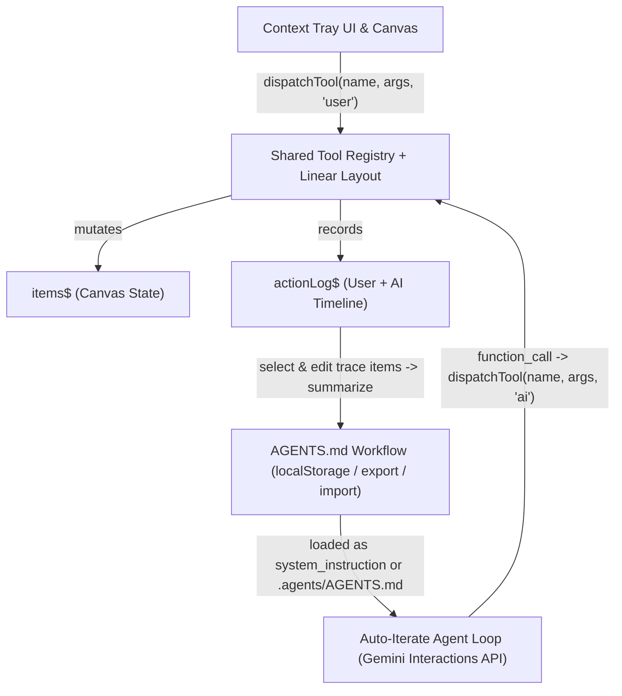

# Plan: Dual-Use Tool Instrumentation, Action Workflows, and Auto-Iterate Agent

**Date:** 2026-11-18  
**Goal:** Track user and AI actions on the Computational Mood Board, let users review and edit individual trace items before summarizing them into a standard [`AGENTS.md`](https://agents.md/) workflow file, and add an **Auto-Iterate** mode that loads `AGENTS.md` to steer a Gemini agent loop over the same UI tools.

---

## Design Principles (Keep It Simple)

1. **Single execution path for UI and AI:** Every design action (human click or AI tool call) goes through one `dispatchTool(name, args, actor)` function. Action logging happens automatically in one place.
2. **Linear top-to-bottom layout:** Tool outputs append into clean rows stacked linearly top-to-bottom below existing cards, avoiding overlapping cards and manual repositioning during autonomous runs.
3. **One tool definition = UI runner + Gemini Function declaration:** Each tool defines its JSON Schema once, which is passed directly to `ai.interactions.create({ tools })`.
4. **Open-standard `AGENTS.md` workflows:** Saved workflows are stored as standard [`AGENTS.md`](https://agents.md/) Markdown documents (plain, high-signal Markdown with no proprietary schema), making them portable across external AI tools (Gemini CLI, Antigravity Managed Agents, Codex, Cursor, Claude Code) and directly loadable back into our own agent.
5. **Lightweight persistence:** Keep the live action log in an RxJS `BehaviorSubject` (ring buffer of recent actions) and persist saved `AGENTS.md` workflows in `localStorage` (no IndexedDB schema migration needed).
6. **Safe cancellation:** Run the Auto-Iterate agent loop through the existing `submitTask` / `AbortController` pipeline so toggling Auto-Iterate off or clicking **Stop** aborts in-flight requests cleanly.

---

## Architecture Overview



---

## Change 1: Instrument Tools for Both UI and AI (with Linear Layout)

### 1.1 Shared Tool Contract (`src/lib/canvas-tools/types.ts`)

Define a minimal, framework-agnostic tool interface whose `parameters` field is directly usable as a Gemini Interactions API `function` tool declaration:

```ts
export type ActionActor = "user" | "ai";

export interface ToolContext {
  items$: BehaviorSubject<CanvasItem[]>;
  apiKey: string;
  signal: AbortSignal;
  actor: ActionActor;
}

export interface ToolExecutionResult {
  summary: string;
  createdCardIds?: string[];
  updatedCardIds?: string[];
  deletedCardIds?: string[];
  data?: Record<string, unknown>;
}

export interface CanvasToolDef<TArgs extends Record<string, unknown> = Record<string, unknown>> {
  name: string;
  description: string;
  parameters: {
    type: "object";
    properties: Record<string, unknown>;
    required?: string[];
  };
  /** Whether the tool is exposed to the AI agent (defaults to true). */
  agentVisible?: boolean;
  run: (args: TArgs, ctx: ToolContext) => Promise<ToolExecutionResult>;
}
```

### 1.2 Linear Top-to-Bottom Layout Helper (`src/components/canvas/layout.ts`)

Add a simple `getLinearRowPositions(items, count, options?)` helper:
- Computes `startY = max(item.y + item.height) + rowGap` (or viewport top when canvas is empty) and aligns to a fixed left margin (`originX`, e.g. viewport left + padding or leftmost existing card).
- Places up to `columns` (default `3` or `4`) cards left-to-right per row, wrapping cleanly to the next row below.
- Used by all instrumented tools so a multi-step human or AI session reads naturally from top to bottom like a design storyboard.

### 1.3 Tool Inventory & Refactoring Scope

Refactor each existing tool component into a thin UI form that invokes `dispatchTool(...)` instead of calling LLM helpers and mutating `items$` directly:

| Tool Name | Current File | Args | Notes |
| :--- | :--- | :--- | :--- |
| `list_cards` | *(new, AI-only)* | `{ onlySelected?: boolean }` | Returns compact `{ id, title, body, hasImage, hasVideo, isSelected, kind }` list so AI can inspect the board without sending huge base64 blobs. |
| `select_cards` | `canvas.component.ts` | `{ cardIds: string[] }` | Updates `isSelected` on `items$`; lets AI target specific cards just like a human. |
| `delete_cards` | `canvas.component.ts` | `{ cardIds: string[] }` | Removes cards by ID. |
| `write_card` | `new-prompt.tool.ts` | `{ text: string }` | Creates a text card (triggers `CardComponent` auto-fill). |
| `render_image` | `new-prompt.tool.ts` | `{ prompt: string, cardIds?: string[] }` | Generates an image card via `generateImage`. |
| `search_references` | `new-prompt.tool.ts` | `{ prompt: string, cardIds?: string[], maxResults?: number }` | Runs the 2-step streaming search (`streamSearchResults$` + `searchImages`). |
| `visualize_concept` | `visualize.tool.ts` | `{ style: "abstract" \| "concrete", cardIds: string[] }` | Runs `visualizeConcept$`. |
| `scan_concept` | `conceptual-scan.tool.ts` | `{ lens: ScanLensId, cardIds: string[] }` | Runs `scanConcepts$` (`emotions`, `material`, `shape`, etc.). |
| `blend_images` | `blend.tool.ts` | `{ instruction: string, cardIds: string[] }` | Requires `>= 2` cards; runs `blendImages`. |
| `design_concepts` | `design.tool.ts` | `{ requirements: string, brandGuide?: string, count?: number, cardIds: string[] }` | Runs `designConcepts$`. |
| `iterate_designs` | `iterate.tool.ts` | `{ direction?: string, brandGuide?: string, count?: number, cardIds: string[] }` | Runs `designConcepts$` in iteration mode. |
| `run_user_testing` | `user-testing.tool.ts` | `{ trait: string, segment?: string, numUsers?: number, cardIds: string[] }` | Generates personas + rankings via `generatePersonas$` + `rankDesigns$`. |

**Explicitly deferred (keep UI-only in v1):**
- `CaptureTool` (requires webcam / file picker), `ExportTool` (file download), `SketchTool` (interactive freehand canvas), `AnimateTool` (slow video gen, optional Phase 2), and Live Voice **Interview** (requires live microphone).

### 1.4 Unified Dispatcher (`src/lib/canvas-tools/dispatcher.ts`)

```ts
export async function dispatchTool(
  name: string,
  args: Record<string, unknown>,
  options: { actor: ActionActor; items$: BehaviorSubject<CanvasItem[]>; apiKey: string; signal?: AbortSignal },
): Promise<ToolExecutionResult>
```

Responsibilities:
1. Look up tool in the registry (throw a structured error if missing or invalid args).
2. Snapshot `inputCardIds` (from `args.cardIds` or currently selected items).
3. Emit a `"running"` `ActionRecord` to `actionLog$`.
4. Execute `tool.run(args, ctx)` (converting RxJS observables via `firstValueFrom` / `lastValueFrom` with `AbortSignal` teardown).
5. Update the `ActionRecord` to `"done"` (with `outputCardIds`, `summary`, `durationMs`) or `"error"`.
6. Return `ToolExecutionResult` to the caller (UI or AI agent).

---

## Change 2: Capture Human & AI Behaviors + Save Workflows

### 2.1 Action Log Store (`src/lib/workflows/action-log.ts`)

```ts
export interface ActionRecord {
  id: string;
  timestamp: number;
  actor: "user" | "ai";
  tool: string;
  args: Record<string, unknown>;
  inputCardIds: string[];
  outputCardIds: string[];
  summary: string;
  status: "running" | "done" | "error";
  error?: string;
  durationMs?: number;
}
```

- `actionLog$ = new BehaviorSubject<ActionRecord[]>([])` (capped at 200 entries).
- **What gets recorded:**
  - All tool invocations from `dispatchTool(...)` (both `"user"` and `"ai"`).
  - Meaningful direct canvas actions from `CanvasComponent`:
    - Card selection changes (debounced/coalesced into a single `select_cards` event so marquee drags don't spam the log).
    - Card text edits (`edit_card` on save/blur).
    - Card deletions (`delete_cards`).
  - **Excluded from log:** raw pointer moves, viewport scrolling, and card drag coordinate frames (too noisy, not semantically useful for workflows).

### 2.2 Editable Trace Builder & `AGENTS.md` Summarization (`src/lib/workflows/workflow-storage.ts`, `src/lib/workflows/summarize-agents-md.ts`)

```ts
export interface EditableTraceStep {
  id: string;
  tool: string;
  args: Record<string, unknown>;
  note: string;
  included: boolean;
}

export interface SavedWorkflow {
  id: string;
  name: string;
  createdAt: number;
  updatedAt: number;
  /** Canonical industry-standard AGENTS.md Markdown (https://agents.md/) */
  agentsMd: string;
  /** Optional edited trace snapshot kept for reference/re-editing */
  sourceSteps?: EditableTraceStep[];
}
```

- **Editable trace before saving:**
  - Selecting actions from `actionLog$` copies them into an editable draft list (`EditableTraceStep[]`) without mutating the immutable raw `actionLog$`.
  - For each trace item, the user can:
    - Edit its key arguments inline (e.g., prompt/instruction text, scan lens, count, trait) or raw JSON args,
    - Add or edit a short **note / rationale** explaining *why* that step matters (e.g., *"Focus on tactile matte materials"*),
    - Reorder (move up/down) or toggle/remove individual items.
- **Summarizing the edited trace into `AGENTS.md` (`summarizeTraceToAgentsMd$`):**
  - On **Save Workflow**, `gemini-4-hydrogen` (`GEMINI_TEXT_MODEL`, `thinking_level: "low"`, `store: false`) synthesizes the edited trace + workflow name/goal into a concise, high-signal [`AGENTS.md`](https://agents.md/) Markdown file following open-standard conventions:
    - Plain Markdown with no mandatory frontmatter or proprietary schema.
    - High signal-to-noise ratio focused strictly on operational instructions that change agent behavior:
      1. `# <Workflow Name>` — concise overview & design objective.
      2. `## Available Canvas Tools` — exact tool names and key parameter conventions used by the workflow.
      3. `## Design Workflow` — ordered, generalizable step-by-step procedure distilled from the edited trace (ephemeral `cardIds` generalized into intent-based selection rules like *"select the top-ranked designs from the previous step"*).
      4. `## Aesthetic & Quality Guidelines` — recurring visual, brand, or evaluation criteria inferred from the user's prompts and notes.
      5. `## Guardrails & Never Rules` — stopping criteria, card/turn limits, and explicit things to avoid.
  - The generated `AGENTS.md` is editable in-place by the user, persisted in `localStorage` (`"moodboard-saved-workflows"`), and supports:
    - **Export / Download `AGENTS.md`** (interoperable with external `agents.md`-compatible tools).
    - **Import / Load `AGENTS.md`** (upload a `.md` file or paste Markdown to create/load a workflow directly without recording a trace first).

### 2.3 Review, Edit & Save Workflow UI (`src/components/context-tray/tools/workflow.tool.ts`)

Add a compact **Workflow** section in the Context Tray (or a slide-over modal triggered from the header):
- **Activity timeline:** Chronological list of `actionLog$` items showing `[User]` / `[AI]` pill, tool name, compact summary, and a checkbox.
- **Trace Editor (inline draft view):** When actions are selected, opens an editable list where each trace item's arguments and note can be edited, reordered, or removed before saving.
- **Save as `AGENTS.md`:** Workflow name input + **Generate & Save `AGENTS.md`** button (runs `summarizeTraceToAgentsMd$`), followed by a Markdown preview/editor with **Download `AGENTS.md`** and **Import `AGENTS.md`** buttons.
- **Saved `AGENTS.md` workflows list:** Dropdown/selector of saved or imported `AGENTS.md` workflows (with edit and delete actions).

---

## Change 3: Auto-Iterate Mode & Gemini Agent Loop

### 3.1 API Research: Direct Model Loop vs. Managed Custom Agent

Per [Building managed agents (`custom-agents`)](https://aistudio.google.com/docs/custom-agents?codelanguage=javascript) and the Interactions API function-calling guide in `@google/genai@^3.6.0`, there are two ways to run the agent loop — and **both consume the exact same `AGENTS.md` file, `tools` declarations, and `function_call` / `function_result` protocol**:

| Approach | Interactions API Call | How `AGENTS.md` Is Loaded | Pros / Trade-offs |
| :--- | :--- | :--- | :--- |
| **Option A (Recommended v1): Direct Model Agent Loop** | `ai.interactions.create({ model: "gemini-4-neon", tools, system_instruction, input, previous_interaction_id, store: true })` | Loaded directly into `system_instruction` alongside the live canvas tool contract & guardrails. | Zero sandbox cold start (~1–2s per turn), GA `v1`, works directly in the browser with no remote environment overhead. |
| **Option B (Optional Upgrade): Managed Antigravity Agent** | `ai.interactions.create({ agent: "antigravity-preview-09-2026", environment: { type: "remote", sources: [{ type: "inline", target: ".agents/AGENTS.md", content: workflow.agentsMd }] }, tools, previous_interaction_id })` | Mounted natively at `.agents/AGENTS.md` (loaded automatically on startup per `custom-agents.md`). | Preview agent (`antigravity-preview-09-2026`), remote sandbox startup latency; resumes via `status === "requires_action"` + `environment: interaction.environment_id`. |

**Recommendation:** Implement **Option A** first with `GEMINI_REASONING_MODEL` (`gemini-4-neon`, `thinking_level: "low"` or `"medium"`) loading the selected `AGENTS.md` into `system_instruction`, and keep the runner behind a small adapter interface so switching to `agent: "antigravity-preview-09-2026"` with `.agents/AGENTS.md` mounted inline is a drop-in configuration swap.

### 3.2 Agent Loop Implementation (`src/lib/agent/auto-iterate-agent.ts`)

```ts
// Core turn loop (Interactions API, @google/genai@^3.6.0)
const systemInstruction = buildAgentSystemInstruction(workflow.agentsMd);
let input: Interactions.Step[] | string = buildInitialAgentPrompt(boardSnapshot);
let previousId: string | undefined;

for (let turn = 0; turn < maxTurns; turn++) {
  if (signal.aborted) break;

  const interaction = await ai.interactions.create(
    {
      model: GEMINI_REASONING_MODEL,
      system_instruction: systemInstruction,
      input,
      tools: getAgentToolDeclarations(),
      previous_interaction_id: previousId,
      generation_config: { thinking_level: GEMINI_REASONING_THINKING },
      store: true, // required for previous_interaction_id chaining
    },
    { signal },
  );

  const executedCallIds = new Set(
    (interaction.steps || [])
      .filter((s): s is Interactions.FunctionResultStep => s.type === "function_result")
      .map((s) => s.call_id),
  );
  const pendingCalls = (interaction.steps || []).filter(
    (s): s is Interactions.FunctionCallStep => s.type === "function_call" && !executedCallIds.has(s.id),
  );

  if (pendingCalls.length === 0) break;

  const functionResults: Interactions.Step[] = [];
  for (const call of pendingCalls) {
    if (signal.aborted) break;
    try {
      const result = await dispatchTool(call.name, (call.arguments ?? {}) as Record<string, unknown>, {
        actor: "ai",
        items$,
        apiKey,
        signal,
      });
      functionResults.push({
        type: "function_result",
        name: call.name,
        call_id: call.id,
        result: [{ type: "text", text: JSON.stringify(result) }],
      });
    } catch (error) {
      functionResults.push({
        type: "function_result",
        name: call.name,
        call_id: call.id,
        is_error: true,
        result: [{ type: "text", text: error instanceof Error ? error.message : String(error) }],
      });
    }
  }

  input = functionResults;
  previousId = interaction.id;
}
```

### 3.3 Auto-Iterate Toggle & Guardrails

- **UI Control:** In the app header (or top of the Workflow section), show:
  - Active `AGENTS.md` workflow selector dropdown (plus quick **Import `AGENTS.md`** option)
  - **Auto-Iterate** toggle switch (disabled if no Gemini API key or no `AGENTS.md` workflow loaded)
  - Live status pill showing current AI step (e.g. `AI: running design_concepts (step 3/12)`).
- **Guardrails:**
  - Hard turn cap per round (`MAX_TURNS = 12`) and max cards cap (e.g. pause if canvas grows by `> 25` new cards in a session) to prevent runaway API spend.
  - Turning the toggle OFF immediately aborts the `AbortController` and stops any in-flight tool/LLM calls.
  - Every AI tool call runs through `dispatchTool(..., { actor: "ai" })`, so AI actions visibly mutate the canvas in real time and appear in `actionLog$` tagged `[AI]`.
  - If the user manually interacts with the canvas during Auto-Iterate, `list_cards` / next turn sees the latest `items$.value` automatically.

---

## Phased Implementation Plan

### Phase 1: Tool Registry + Linear Layout
- [ ] Add `getLinearRowPositions` in `src/components/canvas/layout.ts` + unit tests.
- [ ] Create `src/lib/canvas-tools/types.ts`, `src/lib/canvas-tools/registry.ts`, and `src/lib/canvas-tools/dispatcher.ts`.
- [ ] Extract core tool handlers (`write_card`, `render_image`, `search_references`, `visualize_concept`, `scan_concept`, `blend_images`, `design_concepts`, `iterate_designs`, `run_user_testing`, plus `list_cards`, `select_cards`, `delete_cards`).
- [ ] Refactor UI tool components in `src/components/context-tray/tools/` to call `dispatchTool(..., { actor: "user" })`.

### Phase 2: Action Log, Editable Trace Builder & `AGENTS.md` Workflows
- [ ] Create `src/lib/workflows/action-log.ts` and hook `dispatcher.ts` + `canvas.component.ts` (selection/edit/delete) into `actionLog$`.
- [ ] Create `src/lib/workflows/summarize-agents-md.ts` (`summarizeTraceToAgentsMd$` using `gemini-4-hydrogen` to produce standard [`AGENTS.md`](https://agents.md/) Markdown) + unit tests.
- [ ] Create `src/lib/workflows/workflow-storage.ts` (`loadWorkflows`, `saveWorkflow`, `deleteWorkflow`, `exportAgentsMd`, `importAgentsMd`) + unit tests.
- [ ] Create `src/components/context-tray/tools/workflow.tool.ts` (+ `.css`) with activity timeline, inline trace item editor (edit args/notes, reorder, remove), `AGENTS.md` editor/export/import, and saved workflow selector.

### Phase 3: Auto-Iterate Agent Loop Steered by `AGENTS.md`
- [ ] Create `src/lib/agent/auto-iterate-agent.ts` loading the active `AGENTS.md` into `system_instruction` and running the Gemini Interactions API `function_call` / `function_result` loop with `AbortController`, turn cap, and error recovery + unit tests (mocked `ai.interactions.create`).
- [ ] Wire the **Auto-Iterate** toggle + `AGENTS.md` workflow selector in `src/components/context-tray/tools/workflow.tool.ts` (and status/stop integration with `tasks.ts` / `progress.ts`).
- [ ] (Optional) Add a `useManagedAgent` flag in `auto-iterate-agent.ts` to run the same loop against `agent: "antigravity-preview-09-2026"` with `workflow.agentsMd` mounted inline at `.agents/AGENTS.md`.

### Phase 4: Verification & Docs
- [ ] Add unit tests for `dispatcher.ts`, `summarize-agents-md.ts`, `workflow-storage.ts`, `auto-iterate-agent.ts`, and `getLinearRowPositions`.
- [ ] Update `.github/copilot-instructions.md` and `src/components/context-tray/context-tray.instructions.md` to document the shared tool registry, action log, `AGENTS.md` workflows, and Auto-Iterate agent loop.
