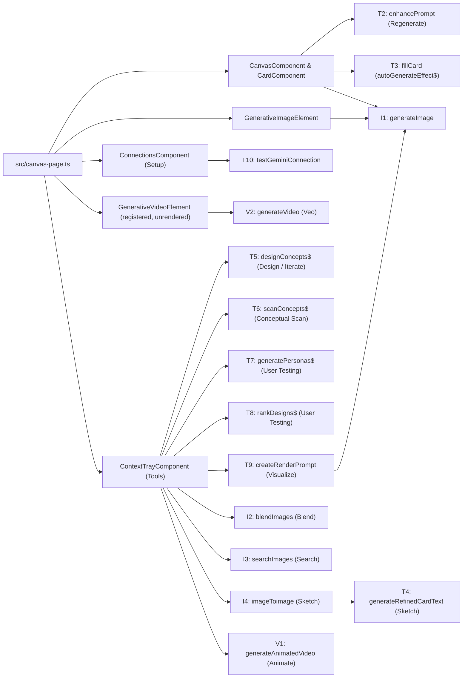

# Gemini Model Upgrade Plan — Canvas Page

Date: 2026-11-18
Scope: every Gemini API call reachable from `src/canvas-page.ts` (computed from its static import graph, 46 files).

## 1. Target models

| Workload | Current | Target | Notes |
| --- | --- | --- | --- |
| Quick text / JSON tasks (`T2–T4`, `T6–T7`, `T9`) | `gemini-3.6-flash` | `gemini-4-hydrogen` | GA 2026-11-12. Google lists it as the recommended upgrade from 3.8 Flash. Thinking levels are `low`/`medium`/`high`/`xhigh`, and the default is **`high`**. **`minimal` returns HTTP 400.** Temperature, top_p and top_k are ignored. Available on free and paid tiers. |
| Complex synthesis & comparative evaluation (`T5`, `T8`) | `gemini-3.6-flash` | `gemini-4-neon` | Mid-tier Gemini 4 model bridging Hydrogen and Carbon for demanding multi-step reasoning, multi-reference synthesis, and comparative evaluation at Flash-tier speed. 1M shared context window; supports `low`/`medium`/`high` (default)/`xhigh` (use `medium`; **`minimal` returns HTTP 400**). **Paid tier only.** |
| Connection test ping (`T10`) | `gemini-2.5-flash-lite` | `gemini-4-hydrogen` (or `gemini-3.5-flash-lite`) | `2.5-flash-lite` is now restricted to prior users, so the Setup test fails for new keys. Google's migration guide lists `gemini-3.5-flash-lite` as the direct Flash-Lite replacement (supporting `minimal`), while `gemini-4-hydrogen` (`low`) directly validates access to the model Canvas uses (including free-tier keys). |
| Image generation / editing | `gemini-3.1-flash-image` (Nano Banana 2) | `gemini-nano-banana-2.1` | **Urgent:** `gemini-3.1-flash-image` reached shutdown on **2026-10-29**; `gemini-nano-banana-2.1` is the current stable replacement. Same Flash cost tier, better quality and text rendering. Supports web and image search grounding, up to 14 reference images, and `image_size` 1K/2K/4K. There is **no 512 tier**. `thinking_level` supports `minimal`/`medium`/`high` and **defaults to `medium`** (unlike 3.1 Flash Image's `minimal`). `temperature`, `topP`, `topK`, `seed`, and `logprobs` are unsupported (return API errors if passed). |
| Image editing (sketch) | `gemini-3.1-flash-lite-image` (Nano Banana 2 Lite) | `gemini-nano-banana-2.1` (see open question Q2) | There is no 2.1 Lite. Google documents Nano Banana 2 Lite as not optimized for reference-guided or sequential editing, strengthening the case for `gemini-nano-banana-2.1` with `thinking_level: "minimal"`. |
| Video (Animate) | `gemini-omni-1.1-flash` | `gemini-omni-1.2-flash` | GA 2026-11-05. **From 2026-12-03, 1.1 requests are routed to 1.2 automatically** and billed at 1.2 rates. Control tags such as `<IMAGE_REF_0>` are deprecated. |
| Video (`<generative-video>`) | `veo-3.1-generate-preview` | `gemini-omni-1.2-flash` or remove (see 3.4) | Veo is no longer on the Gemini API models page. |

> Note: the request mentioned upgrading from "gemini 3.8". The canvas code actually uses **`gemini-3.6-flash`**. No canvas call site uses 3.8.

## 2. Call-site inventory (canvas page only)

All calls use `ai.interactions.create` from `@google/genai`, except `search-images.ts`, which calls the REST `/v1beta/interactions` endpoint directly, and `generate-video-gemini.ts`, which uses the older `models.generateVideos` operation.



**Reactive chaining:** Cards added without a `title` or `body` by `WriterTool`, `CaptureTool`, `SearchTool`, `BlendTool`, or `AnimateTool` automatically trigger `CardComponent` (`autoGenerateEffect$`) → `T3` (`fillCard`). Cards created with an `imagePrompt` (from `T3`, `T5` in `DesignTool`/`IterateTool`, or `T6` in `ConceptualScanTool`) mount `<generative-image>` → `I1`. `VisualizeTool` chains `T9 → I1`, `SketchTool` chains `I4 → T4`, and the card detail dialog's **Regenerate** button chains `T2 → I1`.

### 2.1 Text & reasoning: `gemini-3.6-flash` → `gemini-4-hydrogen` / `gemini-4-neon`

| # | Location | Function → UI trigger | Current thinking | Output | Target model & thinking |
| --- | --- | --- | --- | --- | --- |
| T1 | `src/components/canvas/ai-helpers.ts:68` | `getCaption`, **unused** | `minimal` | text | *(deleted — unused)* |
| T2 | `src/components/canvas/ai-helpers.ts:104` | `enhancePrompt` → canvas card "regenerate" | *(unset → would become `high`)* | text | `gemini-4-hydrogen` (`low`) |
| T3 | `src/components/canvas/ai-helpers.ts:182` | `fillCard` (multimodal `text` + optional `image` + optional `video`) → card auto-fill | *(unset)* | JSON (no schema) | `gemini-4-hydrogen` (`low`) |
| T4 | `src/components/canvas/ai-helpers.ts:277` | `generateRefinedCardText` → Sketch tool | *(unset)* | JSON (no schema) | `gemini-4-hydrogen` (`low`) |
| T5 | `src/components/context-tray/llm/design-concepts.ts:96` | `designConcepts$` → Design + Iterate tools | `minimal` | JSON schema, stream | `gemini-4-neon` (`medium`) — multi-reference synthesis + brand-guide rationalization |
| T6 | `src/components/context-tray/llm/scan-concepts.ts:71` | `scanConcepts$` → Conceptual Scan tool | `minimal` | JSON schema, stream | `gemini-4-hydrogen` (`low`) |
| T7 | `src/components/context-tray/llm/synthetic-users.ts:84` | `generatePersonas$` → User Testing tool | `minimal` | JSON schema, stream | `gemini-4-hydrogen` (`low`) |
| T8 | `src/components/context-tray/llm/synthetic-users.ts:157` | `rankDesigns$` → User Testing tool | `minimal` | JSON schema | `gemini-4-neon` (`medium`) — comparative multimodal design ranking & strict ID ordering |
| T9 | `src/components/context-tray/llm/visualize-concept.ts:85` | `createRenderPrompt` → Visualize tool | `minimal` | JSON schema, stream | `gemini-4-hydrogen` (`low`) |
| T10 | `src/components/connections/test-connections.ts:45` | `testGeminiConnection` → Setup dialog "Test" | *(unset)* | text, stream | `gemini-4-hydrogen` (`low`) |

### 2.2 Images: `gemini-3.1-flash-image` / `-lite-image` → `gemini-nano-banana-2.1`

| # | Location | Function → UI trigger | Request specifics |
| --- | --- | --- | --- |
| I1 | `src/components/design/generate-image-gemini.ts:46` | `generateImage` default model → Render tool, canvas regenerate, and the `<generative-image>` element used by cards and the card dialog | `response_modalities: ["image"]`, optional `response_format.aspect_ratio`. The `model` option can override the default. |
| I2 | `src/components/context-tray/llm/blend-images.ts:24` | `blendImages` → Blend tool | Multi-image input (fits under the 14-reference limit) |
| I3 | `src/components/context-tray/llm/search-images.ts:53` | `searchImages` → Search tool (raw `fetch`) | `google_search` tool with `web_search` + `image_search`, `aspect_ratio: "1:1"`, `image_size: "2K"`. All supported on 2.1. |
| I4 | `src/components/semantic-scan/image-to-image.ts:11` | `imageToimage` → Sketch tool | Currently uses **Lite** (`gemini-3.1-flash-lite-image`) |

The `width: 512, height: 512` passed to `generateImage` is only a UI and cache hint. It is not sent as `image_size`, so the missing 512 tier on 2.1 does not affect it.

**IndexedDB image cache keys:** `src/components/generative-image/generative-image.ts:86` stores cached renders under ``img:${attrs.model ?? "default"}:${attrs.width}x${attrs.height}:${attrs.aspectRatio ?? "auto"}:${attrs.prompt}``. Cards that omit the `model` attribute will continue hitting existing `"default"` cache entries after the upgrade unless retried or given a bumped cache prefix.

### 2.3 Video

| # | Location | Function → UI trigger | Request specifics |
| --- | --- | --- | --- |
| V1 | `src/components/context-tray/llm/animate.ts:323` | `buildAnimateRequest` / `generateAnimatedVideo` → Animate tool | `gemini-omni-1.1-flash`, inline delivery, `store: false`, optional `aspect_ratio` (16:9 / 9:16), `duration` (`4s` / `8s`), and `video_config.task` (including `extend`). The prompt carries `<FIRST_FRAME>` / `<IMAGE_REF_n>` tags built by `getAnimateImageTokens` / `buildAnimateMacro` (`animate.ts:105-158`). |
| V2 | `src/components/generative-video/generative-video.ts:58` → `generate-video-gemini.ts:78` | `<generative-video>` element, **registered in `canvas-page.ts:47` but never rendered in the canvas tree** | Veo `models.generateVideos` operation polling, `durationSeconds: 4`, 720p |

### 2.4 Out of scope (same models, outside the canvas import graph)

These use the same model IDs and should follow in a second pass:
- `src/wizard-page.ts:384` (sets `model="gemini-3.1-flash-lite-image"` on `<generative-image>`)
- `src/components/photo-gallery/photo-gallery.component.ts:128` (`model="veo-3.1-generate-preview"` on `<generative-video>`) and `:138` (`model="gemini-3.1-flash-image"` on `<generative-image>`)
- `src/components/context-tray/llm/scan-moods.ts`
- `src/components/context-tray/llm/generate-title-gemini.ts`, `generate-definition-gemini.ts`, `generate-image-prompt-gemini.ts`
- `src/components/semantic-scan/image-to-text.ts`
- `src/components/virtual-design-system/animator.ts`
- `src/lib/studio-ai.ts` (`gemini-3.6-flash` across Studio scan, synthesis, revision, photo, and sound calls)
- `src/prompt-templates/canvas-*.ts` (and Studio templates under `src/prompt-templates/*`)
- `.github/copilot-instructions.md` and `src/components/context-tray/context-tray.instructions.md` (must be updated in lockstep with code changes per repo workflow rules)

## 3. Breaking changes and risks

### 3.1 Hydrogen and Neon reject `thinking_level: "minimal"`, and leaving it unset defaults to `high`

- 6 call sites (T1, T5–T9) sent `minimal`. Each fails with **HTTP 400** on Gemini 4 models (`gemini-4-hydrogen` and `gemini-4-neon`).
- 4 call sites (T2, T3, T4, T10) sent no level, which would fall back to **`high`** and hurt latency on interactive paths.
- **Fix:** set `thinking_level: "low"` on every Hydrogen call (`GEMINI_TEXT_THINKING`) and `thinking_level: "medium"` on challenging Neon synthesis/ranking calls (`GEMINI_REASONING_THINKING`) through shared constants (see Section 4). The SDK type `ThinkingLevel_2` already allows `"low"` and `"medium"`.

### 3.2 Hydrogen ignores sampling parameters

No canvas call site sets temperature, top_p or top_k, so nothing changes here. The structured-output calls (`response_format` with `mime_type: application/json` and `schema`) are supported, but each should be regression-tested (see Section 5).

### 3.3 Omni 1.2 deprecates control tags

`<FIRST_FRAME>`, `<LAST_FRAME>`, `<IMAGE_REF_n>` and `<VIDEO_REF_n>` still work but "will not be supported in future models." Google recommends describing each input's role in plain language, with `video_config.task` as a fallback.

- **Phase 1:** switch the model ID only. The tags continue to work.
- **Phase 2:** rewrite `getAnimateImageTokens` / `buildAnimateMacro` (`animate.ts:105-158`) to emit natural-language role descriptions (for example, "Use Image1 as the starting frame. Use Image2 as a visual reference, not as an initial frame.") and update the Copy buttons in `animate.tool.ts:282-297` to copy stable `Image1` / `Image2` labels instead of `<FIRST_FRAME>` / `<IMAGE_REF_n>`. Update `animate.test.ts`, `animate.tool.test.ts`, `.github/copilot-instructions.md`, and `context-tray.instructions.md:12-15`.

Other Omni constraints and payload limits to keep in mind:
- Durations can be any whole second from `3s` to `15s` (default `10s`), so the current `4s` / `8s` remain valid.
- First-and-last-frame interpolation and `task: "extend"` requests must be ≤ 10s (durations `> 10s` fail with `invalid_argument`).
- Extending a clip appends 3–10s per turn, up to 30s total.
- Reference-image adherence supports up to **6 reference images**; add a preflight check (`images.length > 6`) in `getAnimatePreflightErrors` (`animate.ts:184`).
- **Inline payload limit (`delivery: "inline"` vs `"uri"`):** `animate.ts:327` currently hardcodes `delivery: "inline"`, whereas Omni 1.2 defaults to 10s (and supports up to 15s) 24fps video with audio that can exceed the 4 MB inline response limit. Add `delivery: "uri"` support with Files API `ACTIVE` polling and media download (matching `docs/20260803-gemini-omni-reference-implementation.html:514-536`) in Phase 2 when widening durations or exposing higher resolutions.
- Editing or extending uploaded videos is unavailable in the EEA, Switzerland and the UK.

### 3.4 `<generative-video>` relies on Veo

V2 uses the Veo operation API, which is no longer listed. The canvas registers the element but never renders it.

**Recommendation:** remove the `GenerativeVideoElement.define(...)` registration from `canvas-page.ts`. If the element is still needed elsewhere (`photo-gallery`, `wizard-page`), port `generate-video-gemini.ts` to `interactions.create` with `gemini-omni-1.2-flash` (`delivery: "uri"` + Files API polling), reusing `extractAnimateVideo`, and remove `src/components/connections/gemini-video.types.d.ts`. That would be a separate change.

### 3.5 SDK version

`package.json` now pins `@google/genai@^3.6.0` (upgraded from `^2.21.0`). Note two SDK 3.x specifics:
- `@google/genai` 3.x requires **Node.js >= 22**, and `.github/workflows/deploy.yml` had no `actions/setup-node` step — add `actions/setup-node@v4` with `node-version: "22"` so GitHub Pages builds succeed.
- SDKs `>= 3.0.0` default to the stable `v1` endpoint (Interactions API is GA on `v1`, vs `v1beta` in earlier versions); standard text/image `ai.interactions.create` model calls work on `v1` (using `response_format` rather than deprecated `response_modalities`), while `gemini-omni-1.2-flash` requires `v1beta` (`api_version: "v1beta"` / `apiVersion: "v1beta"` in `animate.ts`). Note also that `Interactions.CreateModelInteractionParamsNonStreaming` moved under `Interactions.InteractionCreateParams.CreateModelInteractionParamsNonStreaming` in 3.6.0 (`animate.ts`).

### 3.6 Cost

- Hydrogen costs \$1.50 per million input tokens and \$7.50 per million output tokens, thinking included, and is available on the free tier.
- Neon costs \$3.00 per million input tokens and \$15.00 per million output tokens (paid tier only). Using Neon selectively for `designConcepts$` (`T5`) and `rankDesigns$` (`T8`) reserves paid reasoning budget for complex multi-item synthesis and comparative evaluation while keeping quick tasks (`T2–T4`, `T6–T7`, `T9–T10`) on Hydrogen.
- Omni 1.2 is paid-only, about \$0.07/s at 720p. Tier-1 limits start at 8 requests per minute and 40 per day.
- Compare these against the current 3.6 Flash and 1.1 bills before rollout.

### 3.7 Nano Banana 2.1 thinking defaults, sampling parameters, and search step schema

- **Thinking default:** `gemini-nano-banana-2.1` defaults `thinking_level` to `"medium"` (unlike `gemini-3.1-flash-image`'s `"minimal"`). Explicitly set `generation_config: { thinking_level: "minimal" }` on `I1`, `I2`, and `I4` to preserve low-latency card rendering, reserving `"medium"` for `I3` (`searchImages`) or complex multi-reference blends.
- **Unsupported sampling parameters:** Never pass `temperature`, `topP`, `topK`, `seed`, or `logprobs` to `gemini-nano-banana-2.1` (causes API errors).
- **Search SDK migration (`I3`):** `search-images.ts:46` currently uses raw `fetch` against `/v1beta/interactions` without the `Api-Revision: 2026-05-20` header (which `@google/genai` >= 2.0.0 sets automatically) and checks `step.google_search_result?.search_suggestions`. When migrating to `ai.interactions.create`, note that `@google/genai`'s `Interactions.GoogleSearchResultStep` models search steps with `step.type === "google_search_result"` and `step.result` (`Array<{ search_suggestions?: string }>`) rather than `step.google_search_result`.
- **Blend cleanup (`I2`):** Update the stale `gemini flash 2.5 image` JSDoc comment in `blend-images.ts:7`, and preserve `.at(-1)` final-image selection (vs `I1`/`I4` first-image selection).

### 3.8 Task cancellation (`AbortController`) parity

The header `Stop` button (`canvas-page.ts:174` → `stopTasks` → `stopAllTasks`) unsubscribes active tasks queued via `submitTask`, which aborts underlying network requests in `T9`, `I1`, `I2`, `I3`, and `V1`. However, `T2`, `T4`–`T8`, and `I4` (`image-to-image.ts`) do not pass `{ signal: abortController.signal }` to `ai.interactions.create` (and `T3` `fillCard` runs in `CardComponent`'s `autoGenerateEffect$` rather than `submitTask`, also without `AbortController`). Wire `AbortController` teardown in Phase 1/2 so `Stop` (or card unmount/supersede) cancels in-flight Hydrogen and Nano Banana requests instead of continuing token billing.

## 4. Migration steps

### Centralize model IDs & target constants (`src/lib/gemini-models.ts`)

```ts
export const GEMINI_TEXT_MODEL = "gemini-4-hydrogen";
export const GEMINI_TEXT_THINKING = "low" as const;
export const GEMINI_REASONING_MODEL = "gemini-4-neon";
export const GEMINI_REASONING_THINKING = "medium" as const;
export const GEMINI_IMAGE_MODEL = "gemini-nano-banana-2.1";
export const GEMINI_IMAGE_THINKING = "minimal" as const;
export const GEMINI_SEARCH_IMAGE_THINKING = "medium" as const;
export const GEMINI_IMAGE_EDIT_MODEL = "gemini-nano-banana-2.1";
export const GEMINI_VIDEO_MODEL = "gemini-omni-1.2-flash";
```

### Canvas migration executed (Phases 0–2)

1. **Quick Text (`gemini-4-hydrogen`, `thinking_level: "low"`):** Migrate `T2–T4`, `T6–T7`, `T9–T10` to `GEMINI_TEXT_MODEL` / `GEMINI_TEXT_THINKING`; delete unused `getCaption` (`T1`).
2. **Challenging Reasoning (`gemini-4-neon`, `thinking_level: "medium"`):** Migrate `T5` (`designConcepts$`) and `T8` (`rankDesigns$`) to `GEMINI_REASONING_MODEL` / `GEMINI_REASONING_THINKING`.
3. **Images (`gemini-nano-banana-2.1`):** Migrate `I1`, `I2`, `I4` (`GEMINI_IMAGE_THINKING = "minimal"`) and `I3` (`search-images.ts` via `ai.interactions.create` with `GEMINI_SEARCH_IMAGE_THINKING = "medium"` and typed `GoogleSearchResultStep` extraction).
4. **Video (`gemini-omni-1.2-flash`):** Migrate `V1` (`animate.ts` / `animate.tool.ts`) to `GEMINI_VIDEO_MODEL` on `v1beta` with `delivery: "inline"` and `store: false`, replace deprecated `<FIRST_FRAME>` / `<IMAGE_REF_n>` tags with natural-language `Image1`/`Image2` role instructions, add max-6-image and `<= 10s` `extend` preflight validation, expose `15s` duration option, and remove unused `GenerativeVideoElement.define` (`V2`) from `src/canvas-page.ts`.
5. **Cancellation, Prompt Templates & CI:** Wire `AbortController` + `progress$` / `finalize` cleanup across `T2–T8`, `T10`, `I4`, and Canvas/ContextTray tools; update Canvas `src/prompt-templates/canvas-*.ts`, `.github/copilot-instructions.md`, `src/components/context-tray/context-tray.instructions.md`, and `.github/workflows/deploy.yml` (`actions/setup-node@v4` with Node 22).
6. **Follow-up outside Canvas scope:** Migrate the out-of-scope call sites listed in 2.4 (`studio-page.ts`, `wizard-page.ts`, `photo-gallery.component.ts`, dormant `llm/` helpers) in a dedicated pass.

## 5. Verification

- `npm run build` and `npm test`, especially `animate.test.ts`, `animate.tool.test.ts`, and `search-images.test.ts`.
- Manual smoke test on the canvas page with a real key, one task per call site:
  - **Setup:** "Test" (T10)
  - **Card:** auto-fill (T3), regenerate image (T2 + I1)
  - **Tools:** Design / Iterate (T5), Conceptual Scan (T6), User Testing (T7, T8), Visualize (T9), Sketch (T4 + I4), Render (I1), Blend (I2), Search (I3), Animate in each mode (default, starting frame, references, extend) (V1)
- For the JSON-schema calls (T5–T9), confirm the parsed output still matches the schema and that streaming partial JSON still renders progressively.
- Compare latency and paid-tier usage for `T5` / `T8` on Neon (`medium`) and `T2` / `T3` on Hydrogen (`low`) against `3.6-flash` (`minimal`).

## 6. Open questions & follow-up notes

- **Q1. Paid-tier requirement on Neon (`T5`, `T8`).** Because `gemini-4-neon` is paid-tier only, free-tier API keys will fail on Design / Iterate / User Testing design ranking unless switched back to `GEMINI_TEXT_MODEL` (`gemini-4-hydrogen`).
- **Q2. Out-of-scope pages.** `studio-page.ts`, `wizard-page.ts`, `main-page.ts`, and `photo-gallery.component.ts` remain on `3.6-flash` / `3.1-flash-image` / `veo-3.1` until the follow-up pass.

## Sources

- [Gemini models list](https://aistudio.google.com/docs/models)
- [Gemini 4 Hydrogen model card (Google Cloud)](https://docs.cloud.google.com/gemini-enterprise-agent-platform/models/gemini/4-hydrogen)
- [Introducing Gemini 4 Neon (Google Blog)](https://blog.google/innovation-and-ai/models-and-research/gemini-models/introducing-gemini-4-neon/)
- [Gemini Omni Flash video guide](https://aistudio.google.com/docs/omni)
- [Gemini Omni 1.2 Flash model card (Google Cloud)](https://docs.cloud.google.com/gemini-enterprise-agent-platform/models/gemini/omni-1-2-flash)
- [Gemini Nano Banana 2.1 model page](https://aistudio.google.com/docs/models/gemini-nano-banana-2.1)
- [Nano Banana image generation guide](https://aistudio.google.com/docs/image-generation)
